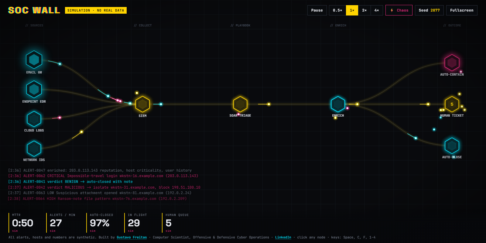
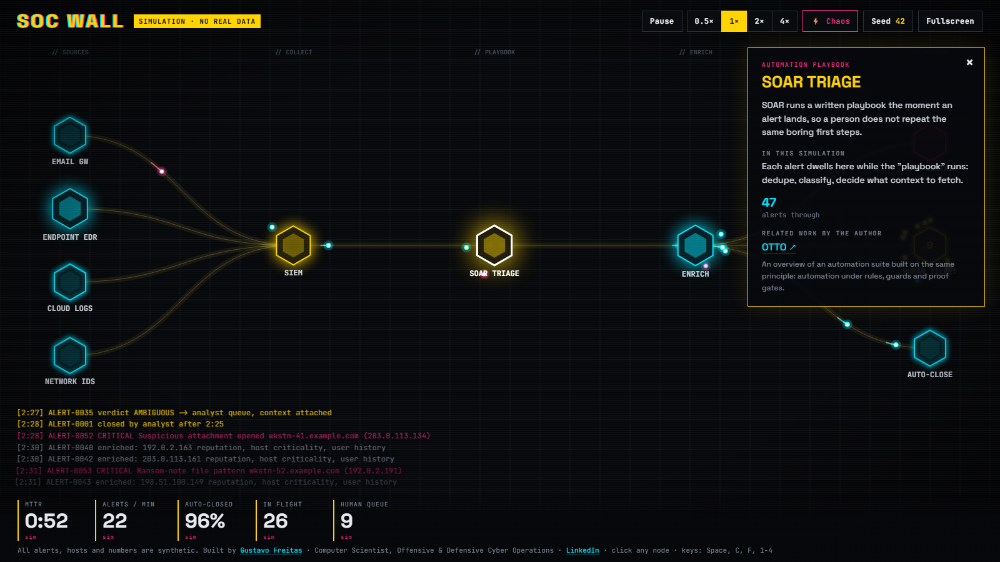

# SOC Wall

**A security operations center as a living art piece. Watch simulated incidents run the whole pipeline.**

A full-screen generative wall: synthetic alerts spawn at email, endpoint, cloud and network sources, funnel through a
SIEM, run a SOAR triage playbook, get enriched, and end in auto-containment, auto-close or a human analyst queue.
Click any stage to learn what it does in plain language. Hit **Chaos** to inject an incident storm and watch the wall
glitch. Everything is simulated: no real data, no network calls, no install, no build step.

**Live demo:** https://tootenramen.github.io/SOC-Wall/

## What's inside

| Path | What it is |
|---|---|
| `index.html` | the page: header controls, event log, side panel, metrics strip |
| `style.css` | the black / yellow / cyan / magenta look, scanlines and glitch effects |
| `app.js` | the simulation (seeded, fixed-timestep) and the canvas renderer, in one dependency-free file |
| `docs/` | screenshots used in this README |

## Use it

1. Open `index.html` in any browser, or visit the live demo. No install, no build step.
2. Click a node (Email GW, SIEM, SOAR Triage, Enrich, Auto-Contain, Human Ticket, Auto-Close) for a plain-language
   explanation and a link to related work.
3. Controls: **Space** pause, **1-4** speed (0.5x to 4x), **C** chaos storm, **F** fullscreen. Put it on a wall display.
4. The alert stream is deterministic. Share a link like `index.html#seed=2077` to replay the same shift.
   `#seed=2077&storm` starts mid-incident; `#node=soar` opens a panel on load.

The MTTR, alerts per minute, auto-closed share and queue numbers are computed from the simulation and labelled
`sim`. Hosts use `example.com` and addresses use the documentation-only ranges `192.0.2.0/24`, `198.51.100.0/24` and
`203.0.113.0/24`.

---
Built by [Gustavo Freitas](https://github.com/Tootenramen) - [LinkedIn](https://www.linkedin.com/in/gustavo-freitas-69b93910b/) - [more projects](https://github.com/Tootenramen)
